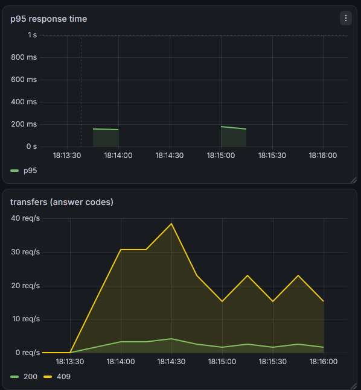
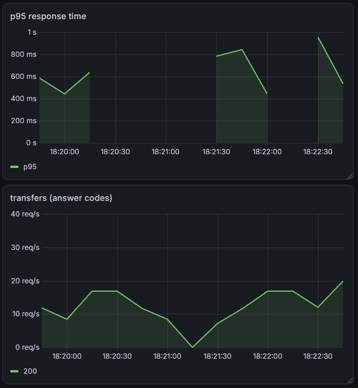

# Ledger Service

A small money-transfer service built around the core ideas of a financial ledger:
double-entry bookkeeping, idempotent operations and safe concurrent updates.
The repository history follows the work: a baseline, a load test that exposed its
limits, and a fix that was measured against it.

## Features

- **Double-entry ledger**: every transfer writes two immutable entries (debit and credit) that sum to zero
- **Idempotency**: repeated requests with the same `idempotencyKey` return `DUPLICATE` and never move money twice (concurrent requests with the same key are on the roadmap)
- **Atomic transfers**: balances and ledger entries are saved in one transaction
- **Pessimistic locking with ordered acquisition**: accounts are locked (`SELECT ... FOR UPDATE`) in ascending id order, so opposite transfers (A to B and B to A) do not deadlock (251 of 500 did without ordering)
- **Optimistic locking** (`@Version`) as a second safety net
- **Error mapping**: 409 on concurrency conflicts, 422 on insufficient funds, 400 on bad input
- **Metrics**: Spring Boot Actuator and Micrometer, scraped by Prometheus (:9090), visualised in Grafana (:3001)
- Flyway migrations, DB-level constraints (`balance >= 0`, unique idempotency key), money as `DECIMAL(19, 4)`

## Stack

Java 21, Spring Boot 3, Spring Data JPA, MySQL, Flyway, Docker Compose, Prometheus, Grafana

## Run locally

```bash
cp .env.example .env        # set your own password
docker compose up -d        # MySQL, Prometheus, Grafana
mvn spring-boot:run
```

## API

```http
POST /api/accounts
{"name": "A", "balance": 1000}

GET /api/accounts/1

POST /api/transfers
{"fromAccId": 1, "toAccId": 2, "amount": 300, "idempotencyKey": "k1"}
```

Response: `{"transferId": 1, "status": "OK"}`, or `"DUPLICATE"` on a repeated key.

## Concurrency experiments

`ConcurrentTransferLoadIT` sends 500 transfers from 50 parallel threads.
It needs the app and MySQL running, so run it from the IDE (it is skipped by `mvn package`).
Everything ran on one local machine with MySQL in Docker.

| Scenario | Result |
|---|---|
| One hot account, optimistic locking only |  about 50 of 500 succeeded in every run (47-52), the rest returned 409 |
| One hot account, pessimistic locking | 500 of 500 succeeded, median 4.6 s over 3 runs after 1 warm-up run |
| Opposite transfers (A to B, B to A), locks in arbitrary order | 249 of 500 succeeded, 251 failed with `Deadlock found` |
| Opposite transfers, locks in id order | 500 of 500 succeeded |

After every run the tests check that no money was lost: balances add up exactly.
Failed requests return quickly, so the run time of the optimistic variant is not comparable
with the other rows. What matters there is the success rate.

## Before / after: concurrent transfers

The screenshots below compare the concurrent-transfer workload before and after ordered account locking. Both use the same axis ranges: p95 latency from 0 to 1 second and request rate from 0 to 40 requests/second, making the runs easier to compare visually.

### Before: optimistic locking only



Under contention, concurrent updates to the same account can conflict. The yellow `409` series shows HTTP conflict responses from the baseline run; the load test observed roughly 50 successful transfers out of 500 in this scenario.

### After: pessimistic locking with ordered acquisition



With pessimistic account locks acquired in ascending account-id order, the test completed all 500 transfers successfully. The green series shows successful HTTP responses in the recorded run.

These screenshots are evidence from a local integration test, not a formal benchmark. Gaps between runs are expected: while no requests are being sent, Prometheus has no request observations from which to calculate p95 latency. A gap should not be read as zero latency.

## Roadmap

- [x] Concurrency tests (hot account, opposite transfers)
- [x] Pessimistic locking with ordered lock acquisition
- [x] Prometheus and Grafana
- [x] Error responses (400, 409, 422)
- [ ] Test concurrent requests with the same idempotency key
- [ ] Retry-on-conflict variant under the same load
- [ ] Balance reconciliation job
